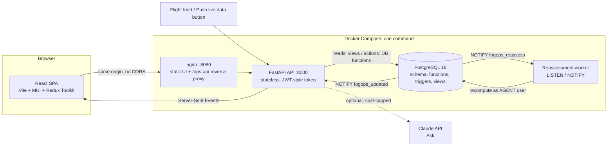

# FOO: Architecture and Scalability

FOO is a disruption control room for airline operations (fog operations and crew duty recovery). This document explains how the solution is built, why, and how far it scales.
Everything here describes code in this repository (`backend/`, `hackathon-app/`, `docker-compose.yml`).
Limits are stated plainly in section 8.

## 1. The problem shape

During fog, flights are held, diverted or delayed, and every change cascades into crew legality (flight duty period
limits), alternate airports, fuel endurance and recovery of the schedule. Several roles (OCC, Dispatch, Crew Control,
Station, Recovery) need the same picture, and **a human must make every decision**. The system may only recommend.

That drives three architectural choices:

1. **The database is the source of truth and the rule engine.** Legality, guardrails and audit live in one place, not in each client.
2. **Events in, state out.** Inputs are append-only facts; the current picture is a projection that can be recomputed.
3. **The agent recommends, humans decide**, enforced by the database, not by convention.

## 2. System overview



| Layer | Technology | Responsibility |
|---|---|---|
| UI | React, Vite, Redux Toolkit (RTK Query), plain CSS design tokens (dark and light, desktop 1024px and up) | Console shell, KPI cards and filters, flight panel, decisions and approvals, rules, integrations, role lenses |
| Edge | nginx | Serves the build, proxies `/ops-api` to the API on the same origin, keeps the SSE stream open |
| API | FastAPI (Python 3.12), psycopg 3 + pool | Auth, thin read endpoints over views, thin write endpoints over DB functions, SSE relay, audit |
| Worker | asyncio task in the API process | Drains `reassessment_queue`, recomputes legality and recommendations |
| Data | PostgreSQL 16 | 47 tables in schemas `fogops` and `hist`, about 70 SQL functions, 40+ triggers, 11 read-model views |

## 3. Key design decisions and why

**Logic in the database, API kept thin.** Reads are `SELECT` from named views. Writes call one SQL function each
(`ingest_flight_event`, `execute_diversion`, `propose_hold_or_divert`, ...). Any client (UI, script, another service) gets
identical rules, and rules are tested once, in SQL (`05_demo_fog_replay.sql` is also an end-to-end test).

**Event sourcing for flight state.** `flight_event` is append-only; `flight_state` is a projection.
- Duplicates are dropped by `(scenario, source, message_id)`, so every feed can be replayed safely (idempotent).
- Each field remembers the timestamp that last set it, so a late message never overwrites a newer value (out-of-order tolerant).
- Status (`AIRBORNE`, `HOLDING`, ...) is **derived**, never typed.

**Scenarios isolate what-ifs.** LIVE, REPLAY and WHATIF scenarios have their own state, crew legs and calculations;
`clone_scenario()` copies a starting point. Operators can test a diversion or crew swap without touching the live picture.

**Recompute, never overwrite.** `fdp_calculation`, `latest_departure_calc`, `recommendation` and `recovery_plan` keep
history (`is_current` / `SUPERSEDED`). Every legality result stores the rule version and every input it used, so any answer is explainable after the fact.

**Fail safe.** Missing or conflicting input never produces "legal". It produces `VERIFICATION_REQUIRED` plus a
`data_exception` row (missing sign-in, no rule for a crew type, stale feed, sheet vs rule mismatch).

**Human in the loop, enforced by triggers.** Non-human roles cannot create decisions or approvals; illegal status
transitions are rejected; decision content is immutable (a change is a new decision). The worker runs as the `AGENT` user, so it hits the same guardrails.

**Audit in two layers.** Database triggers audit every table change (before and after values, scenario clock); an API
middleware audits every action (who, what, outcome, refused attempts included) into the same append-only `audit_log`.

**Schema changes are migrations, not dump and restore.** Numbered files in `backend/migrations/` are applied at API
start by `app/migrate.py` (checksum tracked, one transaction per file, advisory lock so two instances do not race).

**Same-origin deployment.** nginx proxies `/ops-api` to the API, so the browser makes no cross-origin calls and there
is no CORS surface in production.

## 4. Runtime flow: how a change reaches every screen

```
feed message / button  ->  POST /api/events/flight or /api/feed/push
  -> ingest_flight_event()        dedupe, ordering guard, status derivation   (one DB call)
  -> trigger: enqueue_reassessment + pg_notify('fogops_reassess')
  -> worker (SKIP LOCKED claim)   legality, latest legal departure, hold/divert recommendation (as AGENT)
  -> pg_notify('fogops_updated')
  -> API /api/stream (SSE)        browser invalidates its cache and refetches the views
```

The UI falls back to 10 s polling if the stream drops, so a lost connection degrades freshness, not correctness.

### Simulated live feed (`POST /api/feed/push`, "Push live data" button)

Because the supplied data is a snapshot, this endpoint advances the LIVE scenario to "now" through the **same ingestion
path a real feed uses**: flight OUT/OFF/ON/IN, passengers, crew duty status (PLANNED, ACTIVE, COMPLETED), standby release
and fuel estimates (labelled `SIMULATED`). It is idempotent (fixed message ids), never overwrites a value a real source
already set, and deliberately does not invent airport closures or fog, which stay an OCC input.
A real provider replaces it by posting to `/api/events/flight`; nothing downstream changes.

## 5. Scalability

### What scales out today

| Concern | Why it scales |
|---|---|
| API tier | Stateless: auth is an HMAC-signed token, no server sessions. Run N replicas behind nginx or a load balancer. |
| Worker | Jobs are claimed with `FOR UPDATE SKIP LOCKED`, so several workers (or several API replicas) never process the same job. `WORKER_ENABLED=false` lets you split API and worker into separate containers. |
| Ingestion | Idempotent and order-tolerant, so producers can retry, duplicate or reorder without corrupting state. Safe to add parallel consumers or a broker in front. |
| Migrations | Advisory lock makes concurrent starts safe. |
| Static UI | Hashed assets cached for a year; served by nginx; trivially CDN-able. |
| Cost control (Ask) | Predefined questions never call the model; free-text is length-capped, rate-limited per user and per day, cached for identical question plus data. |
| Hot path | Reads hit views over indexed tables (`flight_state`, `flight_event`, crew legs, assignments); history is partition-friendly (append-only, time-keyed). |

### Current bottlenecks, and the fix for each

| Bottleneck | Today | Scale-out path |
|---|---|---|
| **One Postgres** | Single primary, no replica | Add read replicas for the view endpoints (reads are already separate functions in `routes_read.py`); keep writes on the primary. Partition `flight_event` and `audit_log` by month. |
| **SSE uses one DB connection per browser** | Each open stream holds a dedicated `LISTEN` connection outside the pool, so concurrent viewers are capped by Postgres `max_connections` | One shared listener per API process that fans out to clients in memory (about 30 lines), or Redis / NATS pub-sub when running many replicas. |
| **Reassessment queue is not coalesced** | One job per material change; 500 events can queue hundreds of jobs for the same flight; `DONE` rows are never pruned | Coalesce by `(scenario, flight)` while PENDING; prune or partition finished jobs. |
| **Feed push is synchronous** | One request, one transaction, a few seconds for about 170 flights | Move to a background job with a progress endpoint, or batch via `COPY` / a broker consumer. A real feed would arrive per message anyway. |
| **Ask rate limit and cache are per process** | In-memory dicts, so limits multiply by replica count | Move to Redis, or to Postgres with a small counter table. |
| **Pool size** | 10 connections per API process | Tune per replica; front Postgres with PgBouncer in transaction mode when replicas grow. |

### Growth path

1. **Now (demo, one VM):** the compose stack as shipped. Comfortable for tens of concurrent operators.
2. **Next:** split worker into its own container, add PgBouncer, shared SSE listener, queue coalescing.
3. **Regional or fleet scale:** read replica for views, monthly partitions for events and audit, a broker (Kafka or Redis Streams) feeding `ingest_flight_event` consumers, Redis for shared rate limits and caches. No API contract changes are needed for any of these because ingestion and reads already sit behind narrow, idempotent interfaces.

> No load test has been run. The statements above are from reading the design and code, not from measured throughput.

## 6. Reliability and operations

- **Health:** `GET /health` reports DB reachability, whether the schema is current and the latest migration; the API and web containers have Docker `HEALTHCHECK`s, and `web` waits for `api` to be healthy.
- **Restart policy:** `unless-stopped` on every service; Postgres data lives in a named volume.
- **Cold start:** an empty volume restores from `backend/db/init/` automatically; an existing volume is brought current by migrations.
- **Recovery of derived state:** `flight_state` and calculations can be rebuilt from the append-only events and inputs.
- **Reset for demos:** `./reset-db.sh` wipes and restores the volume.
- **Configuration:** everything is environment variables (`.env`); required secrets fail fast in compose if unset.

## 7. Security

- Passwords: PBKDF2-SHA256, 200,000 iterations, per-user salt. Tokens: HMAC-SHA256 signed with `AUTH_SECRET`, with expiry; every route except login requires one.
- Roles (`OCC`, `DISPATCH`, `CREW_CONTROL`, `STATION`, `RECOVERY`, `ADMIN`, `AGENT`) are enforced in the database for decisions and approvals, not only in the UI.
- Postgres is bound to `127.0.0.1` (reach it through an SSH tunnel); only the UI and API ports are published.
- Audit log is append-only and records refused attempts; sensitive fields (`password`, `token`, `authorization`) are redacted before storage.
- The AI assistant gets read-only context, cannot decide anything, and has hard cost caps.
- **Not yet done:** TLS termination (put Caddy or a cloud load balancer in front, see README section 8.4), token revocation, per-role route authorisation at the API layer (the database guardrails already stop role violations on writes).

## 8. Known limitations (honest list)

- Single database, single VM; no automated failover.
- The sections 5 bottlenecks above are real and unmitigated.
- The live feed in this build is simulated. The integration point is real (`/api/events/flight`), but no external provider is wired in.
- Airport status (fog, closures) is manual OCC input by design.
- Crew sign-in times and rosters are planned values from the supplied files; they are not updated by the simulated feed.
- No automated test suite beyond the SQL replay and the expected-output file; no load or chaos testing yet.

## 9. Repository map

```
backend/
  app/            FastAPI: routes_read / routes_write / routes_feed / routes_console / routes_ask, worker.py, stream.py, audit.py, migrate.py
  fogops_db/sql/  schema, functions and triggers, views, reference seed, fog replay (also an e2e test)
  migrations/     numbered, checksummed schema changes applied at API start
  db/init/        first-start restore for an empty volume
hackathon-app/    React SPA, nginx.conf, Dockerfile
docker-compose.yml   db + api + web, one command
```
