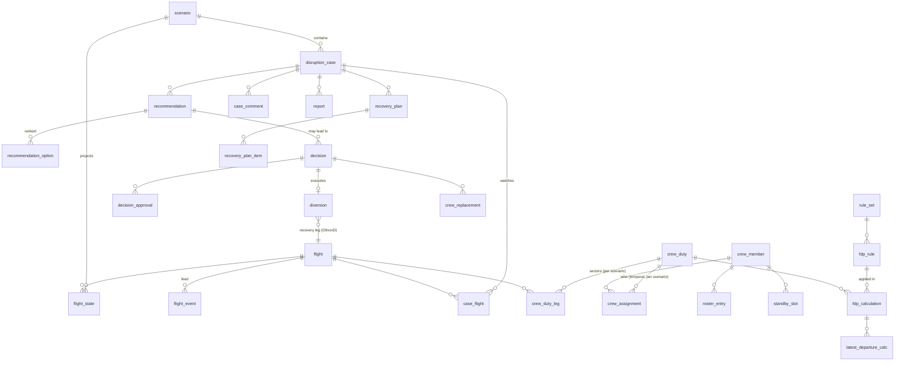

# FogOps PostgreSQL database

Backing store for the **Fog Operations & Crew Duty Recovery Agent**.

The database holds:

- the flight feed;
- crew pairings and FDP rules;
- airport status;
- agent recommendations;
- human decisions;
- station updates;
- recovery plans;
- a complete, append-only audit trail.

It has been tested end to end on PostgreSQL 16 with the files supplied for the hackathon. It requires PostgreSQL 14 or newer.

```
fogops_db/
├── rebuild.sh                     drop + create + load (one command)
├── sql/01_schema.sql              43 tables (schemas: fogops, hist)
├── sql/02_functions_triggers.sql  ingestion, legality engine, guardrails, audit, recovery, report
├── sql/03_views.sql               read models for the frontend
├── sql/04_seed_reference.sql      crew types, roles, demo users, feed sources, LIVE scenario
├── sql/05_demo_fog_replay.sql     final-challenge replay on real 21 Nov flights (also an e2e test)
└── loader/load_data.py            loads the supplied Excel files
```

## Quick start

```bash
pip install pandas openpyxl xlrd psycopg2-binary airportsdata
export PGHOST=127.0.0.1 PGUSER=postgres            # or FOGOPS_DSN=postgresql://...
./rebuild.sh /path/to/hackathon/files fogops       # ~1 min
psql -d fogops -f sql/05_demo_fog_replay.sql        # optional: run the fog replay
```

Expected loader output with the supplied files:

| Item loaded | Count |
|---|---|
| Flights | 855 (plus 30 legs that exist only in the duty sheets) |
| Duties | 524 |
| Crew assignments | 3,224 |
| Roster rows | 26,172 |
| Standby slots | 1,020 |
| Historical flights | 65,943 |
| Block-time routes | 249 |

Legality status of the 524 duties:

| Status | Duties |
|---|---|
| LEGAL | 335 |
| AT_RISK | 26 |
| VERIFICATION_REQUIRED | 163 (see "Open questions") |

## Design principles

1. **Event in, state out.**
   - `flight_event` and `airport_status_event` are append-only.
   - `flight_state` is a projection of those events.
   - Duplicate messages are rejected by `(source, message_id)`.
   - An event that arrives late never overwrites a newer value, because each field remembers the timestamp that last set it.
2. **Status is derived, never typed.** Flight status comes from the actual times (OUT/OFF/ON/IN), the diversion state and holding state. The source `Status` column is always `SCH`, so it is ignored.
3. **The agent recommends; humans decide.**
   - `recommendation` holds what the agent suggests.
   - `decision` holds what a human chose.
   - `decision_approval` holds who authorised it.
   - Triggers block decisions or approvals by non-human roles and illegal status transitions. A decision's content cannot be edited; you record a new decision instead.
4. **Rules are versioned and frozen.**
   - Every legality result stores the `rule_set` and `fdp_rule` it used, plus every input.
   - An approved rule set cannot be edited, only retired and replaced by a new version.
5. **Missing or conflicting input never gives a "legal" result.** Any of the following produces `VERIFICATION_REQUIRED` and an entry in `data_exception`:
   - a missing sign-in time;
   - a crew type with no rule;
   - a stale feed for a flight in progress;
   - the duty sheet disagreeing with the rule set.
6. **Results are recomputed, never overwritten.** `fdp_calculation`, `latest_departure_calc`, `recommendation` and `recovery_plan` keep their history through `is_current` / `SUPERSEDED`.
7. **Scenarios isolate what-ifs.**
   - LIVE, REPLAY and WHATIF scenarios each have their own flight state, crew legs, crew assignments and calculations. `clone_scenario()` copies a starting point.
   - REPLAY and WHATIF scenarios run on a simulated clock (`sim_clock_utc`), and every "when" column is stamped with that clock.
8. **UTC everywhere.** Local time is always derived from `airport.tz`. The roster file is local time, so it is stored as local and as converted UTC side by side.

## Entity relationships (core)



`audit_log` is filled by triggers on every user-facing table. `reassessment_queue` is filled whenever an input changes.

## Table catalogue

| Group | Tables |
|---|---|
| Reference | `airport` (IANA tz, min ground time), `alternate_airport`, `aircraft`, `crew_type`, `block_time_reference` |
| Users and scope | `app_role`, `app_user`, `scenario`, `disruption_case`, `case_flight` (watch list, fog exposure, owner) |
| Rules | `rule_set` (versioned, approved, discretion minutes, band reference), `fdp_rule` |
| Flights | `flight`, `flight_event`, `flight_state`, `feed_source` (freshness), `flight_fuel_estimate` (quality-labelled), `pax_connection` |
| Airports | `airport_status_event` (open/restricted/closed, capacity, forecast reopening, alternate suitability) |
| Crew | `crew_member`, `crew_qualification` (LVP, ETOP, TRN), `crew_duty`, `crew_duty_leg`, `crew_assignment`, `roster_entry`, `standby_slot` |
| Calculations | `fdp_calculation`, `latest_departure_calc` |
| Decisions | `recommendation`, `recommendation_option`, `decision`, `decision_approval`, `diversion`, `crew_replacement` |
| Recovery | `recovery_plan`, `recovery_plan_item` |
| Collaboration and logs | `case_comment`, `audit_log`, `data_exception`, `reassessment_queue`, `report` |
| History | `hist.flight` (incl. 158 diversions), `hist.fuel` (implausible rows flagged) |

## How user actions are stored

Every API transaction starts with `SELECT fogops.set_actor(:user_id);`. The audit trigger uses it to record who did what, and the guardrails use it to check roles.

| UI action | Write | What happens automatically |
|---|---|---|
| Feed message arrives | `ingest_flight_event(scn, source, msg_id, flight_id, type, event_ts, payload)` | Duplicates and out-of-order updates are handled, status is re-derived, freshness is updated, and a reassessment is queued with NOTIFY |
| OCC sets SHJ closed or reopening forecast | `INSERT airport_status_event` | Audited; reassessment queued |
| Agent posts advice | `INSERT recommendation` + `recommendation_option` | The previous open recommendation for that flight is superseded and linked |
| Dispatch decides to divert or hold | `INSERT decision (status PROPOSED)` | Human role enforced; audited |
| OCC approves or rejects | `INSERT decision_approval` | The decision becomes APPROVED/REJECTED and the recommendation becomes ACCEPTED/REJECTED |
| Execute the diversion | `execute_diversion(decision_id)` | Creates the recovery leg (e.g. `G9588D RKT-SHJ`) and the `diversion` record, adds a sector to every affected crew duty, then recomputes legality and latest departure |
| Station update (landed, refuelled, waiting for…) | `UPDATE diversion` | Audited; feeds "what is it waiting for?" |
| Crew swap or replacement | `swap_crew(scn, duty, out, in, reason, sign_in, station, from_leg)` + `INSERT crew_replacement` | Temporal history kept; reassessment queued |
| Comment | `INSERT case_comment` | Role-labelled; append-only |
| Recompute | `compute_flight_legality(scn, flight)`, `compute_latest_departure(scn, flight, buffer_min)` | Stores rule, inputs and margins |
| Recovery order | `build_recovery_plan(scn, case, window_min, weights)` | Arrival slots against capacity, with feasibility flags and reasons |
| Report | `generate_report(case, user)` | Reproducible JSON snapshot with an audit watermark |
| What-if | `clone_scenario(src, name, 'WHATIF', overrides)` | Isolated copy of state, crew and calculations |

**Live updates.** A backend worker runs `LISTEN fogops_reassess` and processes rows from `reassessment_queue`. Typical work is recomputing legality and asking the agent for fresh recommendations. The frontend can then be pushed changes over WebSocket/SSE.

## Frontend read models (views)

| Screen or question | View / function |
|---|---|
| Single flight watch | `v_flight_watch`: status, aircraft, route, ETA, fog exposure, captain, duty margin, recommendation, decision, alternate, latest legal and target departure, owner, data age, open exceptions |
| **Q1** Which crew runs out of legality next? | `v_crew_legality_ranking ORDER BY minutes_until_legal_end` (shows the rule, band, legs and inputs used) |
| **Q2** Where is aircraft X and what is it waiting for? | `v_aircraft_whereabouts WHERE registration = 'A6-…'` |
| **Q3** What time must it leave to land legal? | `v_flight_watch.latest_legal_offblocks_utc / _local`, `operational_target_utc` and the live `departure_legality` |
| **Q4** Who is the alternate crew without breaking rosters? | `standby_candidates(scn, duty, position, station, from_leg)` (legality for the remaining legs, LVP, positioning time, roster conflicts) |
| Recovery order | `v_recovery_plan_current` |
| Decision history | `v_decision_log` |
| Shared timeline | `v_case_timeline` (feed, airport, decisions, approvals, crew, comments on one scenario clock) |
| Airport status, feed freshness, issues | `v_airport_status_current`, `v_feed_freshness`, `v_open_exceptions` |

## Data findings built into the load

- **Time zones:** the OCC rotation and duty sheets are UTC, but the roster is local time.
- **FDP band:** the duty sheet's `maxFdp` agrees with `Crew_FDTL.xlsx` for 96–99% of crew starting in the UAE when the sign-in station's local time is used.
- **Mismatches are flagged, not guessed.** Any disagreement becomes `SHEET_MAXFDP_MISMATCH` with both values and a conservative value.
- **Crew and aircraft are linked by flight number, date and route,** never by registration. Four aircraft swaps are flagged.
- **30 legs appear only in the duty sheets** (for example, returns on 24 Nov). They were created so that crew sector counts are complete.
- **Historical diversions** give the alternate ranking (FJR, RKT, MCT, AAN…) and P90 block times for alternate→SHJ.
- **Dirty fuel rows** (4,649) are flagged as implausible.

## Open questions for the organizers

Each item below is currently handled as "verification required" or as a labelled assumption.

1. **Crew types SO, SEC and EN are not in `Crew_FDTL.xlsx`.**
   - SO blocks a legality verdict.
   - SEC and EN are flagged but do not gate the flight.
2. **Outstation sign-ins disagree with the table**, for example 11:30 in the sheet against 13:00 in the table for 1 leg. This is probably acclimatisation rules, which are not in the supplied file.
3. **The time zone of the "Standby Details" times** is not stated. They were loaded as UTC on the sheet date.
4. **Minimum rest after duty** is not supplied. 12 hours is assumed, and it is used only for roster-conflict checks.
5. **The meaning of the 0-leg FDP rows** and of PTD/PTA in the 16:45 snapshot.
6. **Should LVP qualification be a hard constraint** for landing at SHJ in fog? Today it is stored and shown in the standby candidates.

## Notes

- The LIVE scenario clock is set to the time of the latest snapshot (20 Nov 16:45Z). Once a real feed is connected, set `scenario.sim_clock_utc = NULL` for LIVE so it uses the wall clock.
- The 12-per-hour reopening capacity, road positioning times and holding endurance values in the demo are **simulated or assumed**. They are labelled as such in the data (`quality`, `assumptions`, `notes`).
